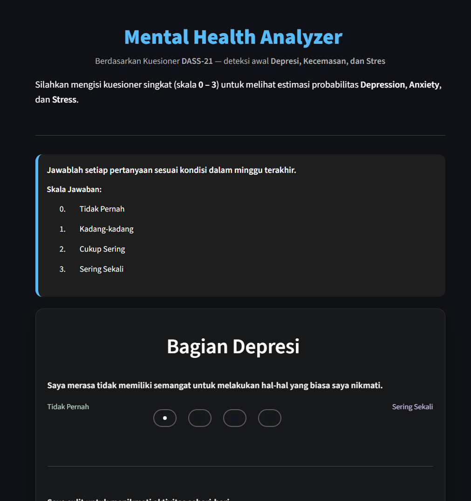
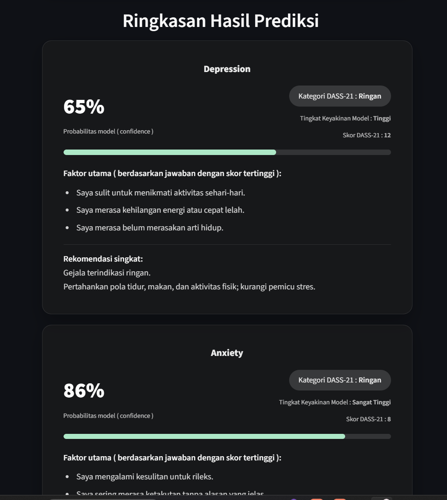
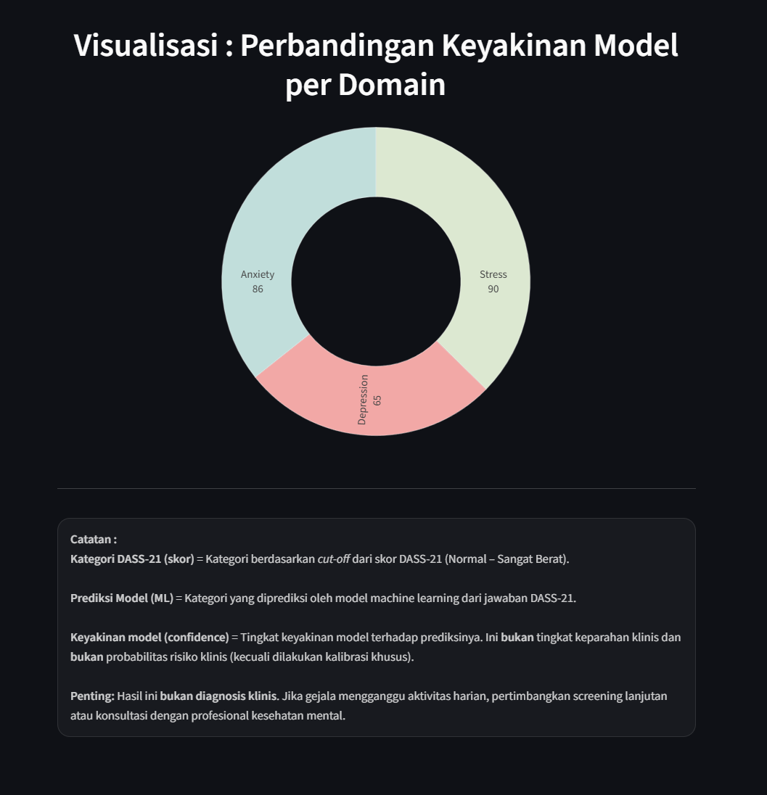

# Mental Health Analyzer — DASS-21

Aplikasi skrining awal berbasis kuesioner **DASS-21** untuk mengestimasi tingkat
depresi, kecemasan, dan stres. Aplikasi dibangun dengan **Python + Streamlit**,
membandingkan **Logistic Regression** dan **Random Forest**, lalu menampilkan
kategori DASS-21, skor, faktor utama, dan rekomendasi awal.

[](https://github.com/revanzarakha/mental-health-dass21/actions/workflows/ci.yml)

> **Bukan alat diagnosis.** Hasil aplikasi adalah skrining awal dan estimasi
> model, bukan diagnosis klinis. Jika gejala mengganggu aktivitas harian,
> konsultasikan dengan profesional kesehatan mental.

<p align="center">
  
  
  
</p>

## Yang dilakukan proyek ini

- Menyajikan 21 item DASS-21 dengan skala 0–3.
- Menghitung skor dan kategori DASS-21 berbasis aturan (*rule-based*).
- Menjalankan model machine learning sebagai estimasi sekunder.
- Menampilkan faktor utama dari jawaban dengan skor tertinggi.
- Memberikan rekomendasi awal dan visualisasi keyakinan model.
- Menyediakan pipeline training yang reproducible (`train.py`).

## Batasan penting

Ini bagian yang paling penting untuk dibaca sebelum menilai hasilnya.

1. **Label diturunkan dari 21 item yang sama.** Fitur model adalah jawaban
   DASS-21, sedangkan labelnya adalah kategori keparahan yang dihitung dari
   jawaban tersebut. Artinya model mempelajari ulang aturan skoring DASS-21,
   bukan menemukan sinyal klinis baru. Akurasi tinggi karena itu wajar.
2. **Dataset sangat tidak seimbang.** Kategori Berat/Sangat Berat mendominasi.
   Akurasi saja bisa menyesatkan, sehingga proyek ini juga melaporkan
   **macro-F1** dan metrik per kelas.
3. **Sampel kenyamanan, bukan sampel acak populasi.** Hasil tidak boleh
   digeneralisasikan ke populasi umum.
4. **Bukan pengganti tenaga profesional.** Aplikasi tidak melakukan diagnosis
   dan tidak boleh dipakai untuk keputusan klinis.

## Dataset

- 443 respons kuesioner DASS-21.
- 21 item, skala 0–3 (Tidak Pernah sampai Sering Sekali).
- Tiga domain: depresi, kecemasan, stres (skor 0–42).
- Dataset sudah dide-identifikasi: timestamp dan data demografi dihapus.
  Detailnya ada di [`data/README.md`](data/README.md).

Distribusi label setelah cut-off DASS-21 diterapkan:

| Domain | Normal | Ringan | Sedang | Berat | Sangat Berat |
|---|---:|---:|---:|---:|---:|
| Depresi | 53 | 42 | 51 | 55 | 242 |
| Kecemasan | 31 | 19 | 49 | 22 | 322 |
| Stres | 87 | 20 | 55 | 146 | 135 |

## Metode

- Pembagian data: **80% train / 20% test**, stratified, `random_state=42`.
- Pipeline: `StandardScaler` + model.
- Model:
  - **Logistic Regression** (`lbfgs`, `class_weight="balanced"`, `max_iter=2000`)
  - **Random Forest** (300 trees, `min_samples_leaf=3`, `class_weight="balanced"`)
- Validasi: **3-fold Stratified Cross-Validation**.
- Metrik: accuracy, macro precision/recall/F1, F1 weighted, dan metrik per kelas.
- Artefak: model disimpan dengan `joblib` di `models/`, metrik di `results/`.

## Hasil

Nilai pada data uji (89 sampel):

| Domain | Model | Accuracy | Macro F1 | CV accuracy (3-fold) |
|---|---|---:|---:|---:|
| Depresi | Logistic Regression | 0.933 | **0.875** | 0.878 ± 0.015 |
| Depresi | Random Forest | 0.798 | 0.675 | 0.806 ± 0.011 |
| Kecemasan | Logistic Regression | 0.933 | **0.844** | 0.851 ± 0.017 |
| Kecemasan | Random Forest | 0.910 | 0.662 | 0.880 ± 0.017 |
| Stres | Logistic Regression | 0.910 | **0.884** | 0.847 ± 0.043 |
| Stres | Random Forest | 0.753 | 0.681 | 0.779 ± 0.045 |

Tabel lengkap dan metrik per kelas ada di
[`results/metrics.md`](results/metrics.md) dan
[`results/metrics.json`](results/metrics.json).

**Kenapa Logistic Regression?** Model ini memberi macro-F1 lebih tinggi di
ketiga domain dan lebih stabil pada data uji. Random Forest memang lebih tinggi
pada CV kecemasan, tetapi performa ujinya lebih rendah. Logistic Regression
juga lebih mudah dijelaskan dan lebih ringan untuk aplikasi demo.

**Catatan interpretasi:** akurasi 0.91–0.93 terlihat tinggi, tetapi sebagian
besar berasal dari kelas mayoritas (Berat/Sangat Berat). Macro-F1 (0.84–0.88)
lebih jujur untuk menggambarkan performa antar kelas.

## Struktur repo

```text
.
├── app.py                     # aplikasi Streamlit
├── train.py                   # pipeline training + evaluasi
├── requirements.txt
├── data/
│   ├── dass21_deidentified.csv
│   └── README.md
├── models/                    # artefak model + feature_columns.json
├── results/                   # metrics.json / metrics.md
├── assets/                    # screenshot aplikasi
├── tests/                     # unit test dataset + label mapping
└── .github/workflows/ci.yml
```

## Menjalankan

```bash
python -m venv .venv

# Windows
.venv\Scripts\activate

# Linux / macOS
# source .venv/bin/activate

pip install -r requirements.txt

# opsional: latih ulang model (menimpa artefak di models/)
python train.py

# jalankan aplikasi
streamlit run app.py
```

Aplikasi berjalan di `http://localhost:8501`.

## Reproducibility

- Semua proses memakai `random_state=42`.
- Versi dependensi dipin di `requirements.txt`.
- Dataset yang dipublikasikan sudah dide-identifikasi dan cukup untuk
  mereproduksi hasil tanpa metadata responden.
- `python train.py` akan menulis ulang `models/` dan `results/`.

## Tests

```bash
python -m unittest discover -s tests -v
```

Test memeriksa bentuk dataset, rentang jawaban/skor, jumlah fitur, dan batas
cut-off kategori DASS-21.

## Yang saya pelajari

- Akurasi tinggi tidak otomatis berarti model bagus saat kelas tidak seimbang;
  macro-F1 dan metrik per kelas perlu dilaporkan.
- Label yang diturunkan dari fitur yang sama membuat tugas menjadi
  *rule reproduction*, bukan prediksi klinis. Ini harus dijelaskan, bukan
  disembunyikan.
- Pipeline training dan aplikasi demo sebaiknya dipisahkan agar artefak bisa
  direproduksi dan diuji.

## Author

**Rakha Revanza Putra Effendy**

- Portofolio: [revanzarakha.github.io/Portfolio_RakhaRevanza](https://revanzarakha.github.io/Portfolio_RakhaRevanza/)
- GitHub: [github.com/revanzarakha](https://github.com/revanzarakha)
- Email: revanzarakha@gmail.com

## License

[MIT](LICENSE)
